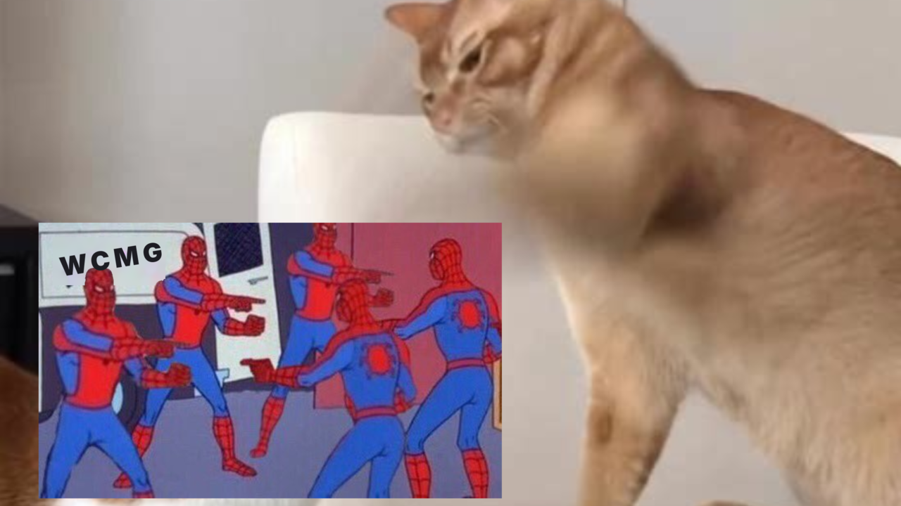

# Who Crashed My Game (WCMG)

A standalone Windows tool that reads what Mortal Shell II and UE4SS leave behind after a crash and says who most likely caused it: a UE4SS Lua or C++ mod, a pak container, UE4SS itself, a changed game file, the GPU side, or the game. It explains each finding in plain words with the evidence, and packs a support ZIP for bug reports.

One exe, no installer, no network, nothing written to the game folder.



## For players

1. Extract the release ZIP anywhere and run `WCMG.exe`.
2. It looks for the game in your Steam libraries. If it guesses wrong, click Browse and pick the `Sparta` folder (the one with `MortalShell2` inside).
3. Click Diagnose. The verdict is at the top; the list below has every finding with its confidence, who it blames, why, and what to do.
4. Reporting a crash to a mod author? Click Collect ZIP and attach the file. It contains the report, the newest crash reports with their minidumps, UE4SS.log, mod logs and config. No save games.

Command line: `WCMG.exe --cli "D:\SteamLibrary\steamapps\common\Sparta" [--md|--json] [--zip out.zip]`.

Under Proton: run it inside the game's prefix (`protontricks-launch --appid 2584270 WCMG.exe`) so it finds the crash reports, or use `wcmg_cli` on Linux with `WCMG_SAVED_DIR` pointing at the prefix's `AppData/Local/MortalShell2/Saved`.

## What it reads

| Source | Where | What it gives |
| --- | --- | --- |
| Unreal crash reports | `%LOCALAPPDATA%\MortalShell2\Saved\Crashes\UECC-*` | crash type, error, call stack (module + offset), GPU breadcrumbs, engine build, memory, DLSS/FSR state, player shell and level |
| Minidumps | `UEMinidump.dmp` beside each report, `ue4ss\crash_*.dmp` | every DLL inside the process, exception record, a scan of the crashing thread's stack |
| UE4SS | `Binaries\Win64\ue4ss` | build hash, settings, mods.txt / enabled.txt, each mod's DLLs and Lua, hook usage, the log with Lua errors, the proxy DLL beside the exe |
| CSS, CSSX, CCS | `ue4ss\Mods\{CustomShellSystem,CSSX,CCS}` | version, active core, loader hash, log errors, corrupt state files, dev channel |
| Pak containers | `Content\Paks`, `~mods`, `LogicMods` | package ids from each `.utoc`, names from the directory index, overrides of game packages, collisions between mods, incomplete trios, stray files |
| Game files | `Manifest_UFSFiles_Win64.txt`, `Manifest_NonUFSFiles_Win64.txt`, `appmanifest_2584270.acf` | missing files, extra files beside the exe, Steam build id, exe hash and date |
| Config | `Saved\Config\Windows\Engine.ini`, `GameUserSettings.ini` | forced frame generation, Reflex, scalability |

## How it decides

`src/core/rules.cpp` holds every rule. Each one reads the evidence and produces findings with a severity (info to critical), a confidence, who to blame, a summary, a longer explanation, quoted evidence and advice. The verdict is the top finding after sorting by severity then confidence, with the next two different blames listed as alternatives.

The strongest signals, in order: a mod module at the top of a crash call stack; a mod module anywhere on it; a GPU crash with frame generation or overlays active; Lua errors naming a mod; an incomplete or colliding container; a replaced or missing game file; mods older than the last game update.

Without symbols for the game the tool reasons from modules and offsets, not function names. Stack-scanned frames from a minidump are candidates, never a proven chain; the rules prefer Unreal's own call stack from the crash context.

`src/core/knowledge.json` carries author-maintained notes (known game builds, known UE4SS builds, mods with known issues, overlay DLL names). A `known.json` beside the exe overrides it, so the list can be updated without a new build.

## Building

Linux host, cross-compiled with the same toolchain as CSS (clang-cl, lld-link, xwin SDK under `~/.xwin`):

```sh
cmake -S WCMG -B WCMG/build/windows -G Ninja -DCMAKE_BUILD_TYPE=Release \
      -DCMAKE_TOOLCHAIN_FILE=../native/toolchain-clang-cl.cmake
cmake --build WCMG/build/windows          # WCMG.exe (GUI) and wcmg_cli.exe
```

Tests and the Linux CLI:

```sh
cmake -S WCMG -B WCMG/build/linux -G Ninja -DCMAKE_BUILD_TYPE=Release
cmake --build WCMG/build/linux
WCMG_GAME_DIR=/path/to/Sparta WCMG_SAVED_DIR=/path/to/Saved ctest --test-dir WCMG/build/linux
```

Tests run their synthetic fixtures everywhere and add real-install checks when the two variables are set.

Layout: `src/core` is portable (scanners, rules, report, zip bundle), `src/win` is the Win32 GUI and registry discovery, `src/cli` the console runner, `vendor` holds nlohmann/json and miniz, `tests` one file per scanner, `assets` the artwork, `docs` the Nexus texts.

## Release

`tools/release.sh` (see below) builds the Windows exe, copies README and the artwork, and writes `dist/wcmg-v<version>/MSII-WCMG-v<version>.zip` plus its sha256. Nexus takes archives, not bare executables.
